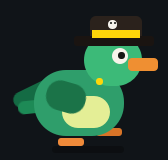

# Boris

Boris is a pirate parrot who walks on your [Omarchy](https://omarchy.org) / Hyprland desktop. Click him and he hops. Drag him where you want. Right-click opens his settings window — size, attention, avatars, and pet management live there. Size changes apply on the desktop right away.

He stays out of the way: the pet window is only as big as he is, so the rest of the screen keeps your clicks. While he walks he does not steal the keyboard. Launching Boris again brings the settings window forward.



**License:** MIT (see [`LICENSE`](LICENSE))  
**App icon:** parrot only — no cursor / pointer branding.

## Features

- **Desktop pet** — walk, hop, drag, perch, then walk the floor again
- **Settings window** — size 40–200%, attention toggles, shortcuts
- **Apps menu** (title bar → **Apps**)
  - **Pet** — current look, switch avatars, pet settings
  - **Avatars** — add named pictures/GIFs, preview, save, switch, remove
- **GIF avatars** — picker accepts GIF; files keep `.gif`; animated preview in draft, catalog, Pet page, and on the desktop (`AnimatedImage`)
- **Still images** — PNG, JPEG, WebP, SVG
- **Frames folders** — `idle.png` plus optional walk/talk frames
- **Attention** — glance at the pointer, idle antics, nap when left alone
- **Alive Companion** — hop vs talk/excited, optional chirps, short pirate lines, local mic wake-word (say his name / configurable phrase)
- **Omarchy theme** — accent and rounding follow the desktop where possible
- **Danish / English** strings via `src/i18n/`

Glance / layer-shell companion habits follow [Nala](https://github.com/yappologistic/Nala) (MIT). Boris keeps his own parrot, settings, and avatar store — not Nala’s SDF body.

## Actions

| Action | What it does |
| --- | --- |
| Click | Hop |
| Drag | Move him. Drop near the floor to walk; higher to perch |
| Right-click | Open settings |
| Title bar **Apps** | Open the in-app menu (Pet, Avatars, Settings) |
| Size slider | 40%–200%, saved for next launch |
| Walk the floor | Leave a perch and roam |
| Space | Hop (settings focused) |
| Q | Quit (settings focused) |
| Escape | Close settings / go back a page |
| ? | Show or hide the key list |

## Requirements

- Linux with Wayland (Hyprland / Omarchy)
- Qt 6 (base, declarative/QML, Wayland, SVG, imageformats)
- Layer Shell Qt
- xdg-desktop-portal (file picker)

## Build

```sh
bin/build
./build/boris
# or open settings immediately:
./build/boris --settings
```

```sh
bin/test          # offscreen unit tests
bin/package       # release tarball under dist/
bin/install       # Arch package via makepkg (needs makepkg)
```

Preview without a display:

```sh
./build/boris --preview screenshot.png
```

## Alive Companion

Alive Companion (v0.2.0) adds hop vs talk/excited moods, optional chirps, short pirate lines, and local mic wake-word (default phrase `boris`, no cloud / no push-to-talk). Enable wake listening in settings, or type a line containing the wake phrase via `submitWakeLine`. Optional reply API keys stay out of the offscreen suite — unit tests never need network or credentials.

### Test plan

Automated (`QT_QPA_PLATFORM=offscreen bin/test`):

- [ ] Hop mood lifts; talk mood does not share the hop lift
- [ ] Click / Space hops (`mood == hop`), not a shared `react`
- [ ] `Config` persists `chirpsEnabled` and `wakePhrase` (default `boris`)
- [ ] `WakeWord::submitTranscript`: `"hey boris"` matches, `"hello"` does not (no mic)
- [ ] `Personality::pickLocalLine()` returns a non-empty local line
- [ ] `Backend::submitWakeLine` ignores non-matches; wake hit sets listening (no API key / no mic)

Manual (desktop):

- [ ] Click → hop animation; talk / speech UI does not reuse hop
- [ ] Chirps toggle in settings persists across relaunch
- [ ] Wake phrase setting saves; change it and confirm the new phrase is remembered
- [ ] Wake-word mic (manual): say the wake phrase near a working mic and confirm he reacts; say an unrelated word and confirm he stays quiet (not covered in offscreen CI)
- [ ] With no reply API key, speech still shows a local pirate line

## Install (Arch / Omarchy)

```sh
bin/install
```

Or unpack a release tarball and run the included `install-user.sh` to place the binary, desktop entry, and parrot app icon under `~/.local`.

## Package / release artifact

`bin/package` writes:

```text
dist/boris-<version>-linux-<arch>.tar.gz
```

Contents: `boris` binary, `LICENSE`, `README.md`, `boris.desktop`, `boris.svg` (parrot), `install-user.sh`.

## Data

Runtime data (avatars, settings) lives under the app data directory, typically:

```text
~/.local/share/boris/
  avatar/           # active look + library/
  settings.json     # size + attention prefs
```

Named looks are copied into `avatar/library/` (originals are never modified). GIFs are stored as `.gif` so animation is preserved.

## Development layout

| Path | Role |
| --- | --- |
| `src/` | C++ backend + QML UI |
| `src/AppsMenu.qml` | In-app Apps launcher |
| `src/AvatarsPage.qml` | Named avatar library UI |
| `src/PetPage.qml` | Pet management UI |
| `src/AvatarLook.qml` | Still + GIF preview (`AnimatedImage`) |
| `pkgbuild/` | Arch packaging + parrot app icon |
| `tests/` | Qt Test suite |
| `bin/` | build / test / package / install |

## License

MIT — see [`LICENSE`](LICENSE). Theme, translation, and portal patterns follow Omacut/Monologue (MIT). Hyprland pointer tracking in `src/cursor.*` is adapted from Nala (MIT); that is runtime code, not an icon asset.
